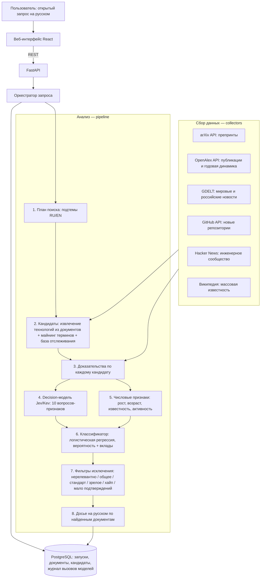

# Архитектура и методология

## Схема

Три слоя разделены по каталогам, как требует ТЗ:

| Слой | Каталог | Что делает |
|---|---|---|
| Парсинг / сбор | `backend/app/collectors` | Адаптеры источников в единый формат `RawDoc`, кэш, повторы, ограничение частоты по правилам API. Сбой источника не прерывает запрос. |
| Инференс / анализ | `backend/app/pipeline`, `backend/app/decision`, `backend/app/ml`, `backend/app/llm` | Кандидаты, признаки, классификатор, правила исключения, досье. |
| Интерфейс | `frontend` + `backend/app/api` | Веб-интерфейс на русском и REST API. |

## Модели и маршрутизация

Все модели выбираются явно в `.env`. Каждое обращение записывается в таблицу `model_calls`: провайдер, модель, назначение, запрос, ответ, задержка. Журнал доступен во вкладке «Журнал моделей» на странице запроса.

| Роль | Модель | Как используется | Согласование |
|---|---|---|---|
| Decision-модель (извлечение признаков) | **Jev** (TypeSafe AI, System One API, `jev-latest`) | Отвечает вероятностями на 10 атомарных вопросов о тексте доказательств (`noul` / `score`). Ответы — признаки классификатора. Сама не решает, является ли технология сигналом. | Согласовано экспертами Газпромбанк.Тех 23.09.2026 |
| Decision-модель, локальная замена | **Kev-0.8B / 4B** (Apache-2.0, Hugging Face `jaredpalmer/kev-*`) | Тот же API, переключение `DECISION_PROVIDER=kev`. | Локальная модель HF — разрешена ТЗ |
| Decision-модель, офлайн | Словарные правила | Работает без сети и ключей (разработка, сбои). Помечается в журнале как `heuristic`. | — |
| LLM для текстов на русском | GigaChat 2 / YandexGPT 5 / gpt-4.1 (по выбору) | Расширение запроса, извлечение названий технологий из найденных документов, русские резюме источников, досье. Только по документам, со ссылками. | Из списка ТЗ |
| Классификатор слабого сигнала | Логистическая регрессия (scikit-learn), наша | Итоговая вероятность и вклад каждого признака. Веса хранятся в открытом JSON. | — |

Выдача никогда не формируется из памяти языковой модели: каждый кандидат проходит сбор доказательств из открытых источников, а в досье LLM получает только найденные документы.

## Почему decision-модель, а не просто LLM

- Вопрос «это массовая технология?» к генеративной LLM даёт текст, который приходится разбирать и который не калиброван. Decision-модель возвращает вероятность за один проход — это прямой численный признак.
- Десять вопросов на кандидата × 45 кандидатов = 450 оценок на запрос. Jev отвечает на все вопросы к одному документу параллельно, стоимость — $0.042 за миллион входных токенов.
- Интерпретируемость: в карточке видно, какой вопрос какой ответ получил и как он повлиял на итоговую вероятность.

## Признаки

| Группа | Признак | Смысл |
|---|---|---|
| Библиометрия (OpenAlex) | `log_total_works`, `recent_share`, `growth`, `age_years` | Слабый сигнал — мало работ, почти все свежие, быстрый рост, тема молодая |
| Известность | `wiki_exists`, `log_wiki_views` | Устоявшаяся популярная статья в Википедии — признак мейнстрима |
| Инженерная активность | `log_gh_repos_12m`, `log_hn_12m` | Разработчики начинают экспериментировать |
| Доказательства | `fresh_preprints`, `share_science`, `log_evidence` | Свежесть и научность подтверждений |
| Decision-модель | `specific_tech`, `mass_adoption`, `market_leaders`, `standard`, `early_stage`, `independent`, `hype`, `novelty`, `benefit`, `maturity` | Ответы на вопросы по текстам источников |

Числовые признаки считаются по одинаковому набору источников при обучении и при живом поиске, чтобы распределения не расходились.

## Обучение и оценка (этап 1)

- Положительные примеры: 100 слабых сигналов организатора (`backend/data/seed/weak_signals_2026.json`), для каждого — англоязычная поисковая фраза (`positive_terms.json`).
- Отрицательные примеры: ~140 технологий, собранных командой (`negatives.json`), с типом: `mature` — массовое внедрение, `standard` — стандарт/протокол, `hype` — маркетинговый шум, `broad` — слишком общая область.
- Для каждого примера доказательства собираются тем же кодом, что и в живом поиске, на фиксированную дату (23.09.2026).
- Оценка: 5-кратная стратифицированная кросс-валидация (Precision, Recall, F1, ROC-AUC, Brier), абляция групп признаков, перенос на новую область (обучение без одной области → проверка на ней).
- Отчёт: `backend/data/model/metrics.json` и страница «Методология и качество».

Ограничение, которое мы честно фиксируем: отрицательные примеры выбраны командой, поэтому метрики показывают способность отделять слабые сигналы от явно зрелых, стандартных и хайповых тем. Более трудные пограничные случаи проверяются на живых запросах.

## Правила исключения

Применяются до ранжирования; порог и причина видны в интерфейсе.

| Код | Условие | Причина в интерфейсе |
|---|---|---|
| `irrelevant` | релевантность запросу < 0.34 | Нерелевантно запросу |
| `not_technology` | «это инновация: технология, подход, новый тип продукта или инструмента» < 0.3 | Не инновация (документ, репозиторий, явление, организация) |
| `product` | «название продукта / компании» ≥ 0.6 | Отдельный продукт или компания |
| `broad` | «конкретная технология» < 0.25 | Слишком общее направление |
| `standard` | «действующий стандарт» ≥ 0.6 | Отраслевой стандарт |
| `mature` | массовое внедрение ≥ 0.6, или рынок с лидерами ≥ 0.65, или популярная статья Википедии при возрасте темы ≥ 8 лет, или > 20 000 научных работ | Зрелая технология |
| `hype` | маркетинговый шум ≥ 0.75 при доле научных источников < 20% | Маркетинговый шум |
| `low_evidence` | меньше 3 подтверждений | Недостаточно подтверждений |
| `low_trust` | нет ни одного источника со средним или высоким доверием | Только первичные индикаторы |
| `low_probability` | вероятность классификатора < 0.5 | Низкая вероятность сигнала |

Оставшиеся ранжируются по `вероятность × (0.6 + 0.4 × релевантность)`; первые 15 — итоговая выдача.

## Доверие к источникам

`backend/app/pipeline/trust.py` — детерминированные правила: научные публикации и регуляторы — высокий уровень; препринты, профессиональные СМИ и репозитории — средний; пресс-релизы, блоги, соцсети и обсуждения — пониженный. Пресс-релиз или блог не может быть единственным основанием: такой кандидат исключается с причиной `low_trust`.

## База отслеживаемых сигналов

Сигналы из датасета организатора используются как база отслеживания: если запрос относится к их области, они добавляются в пул кандидатов и **перепроверяются по живым источникам наравне с новыми**. В выдаче такие позиции помечены «из базы отслеживания», новые — «новый кандидат». Отключается `USE_WATCHLIST=false`.
